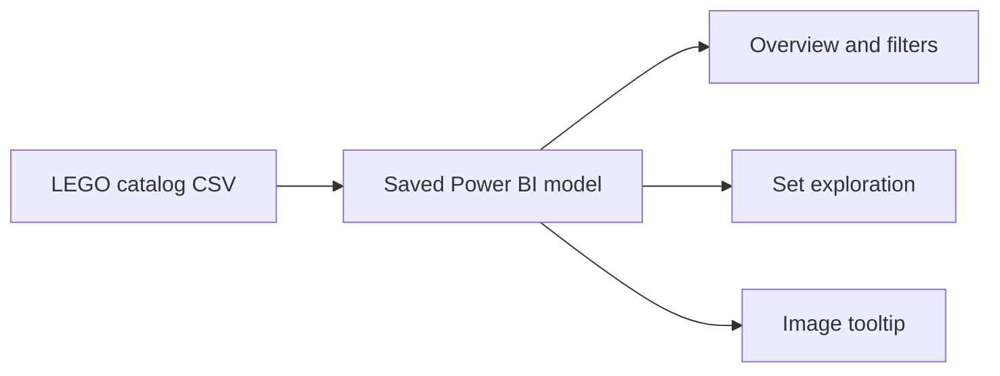
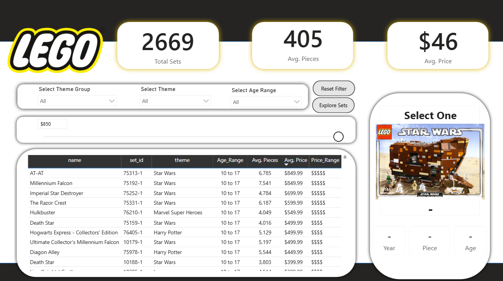
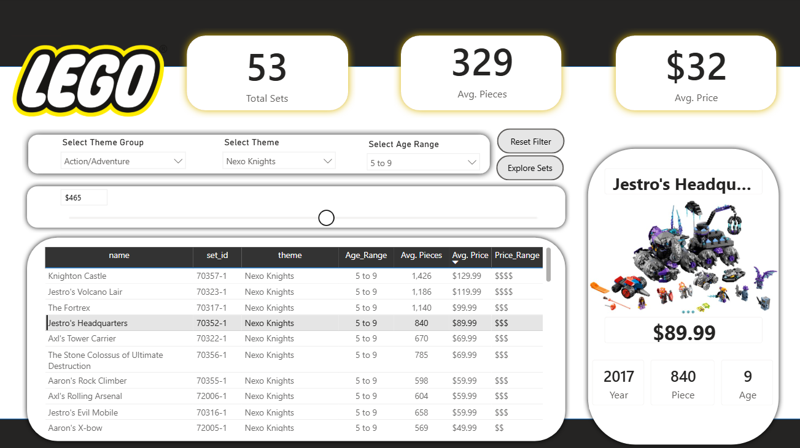
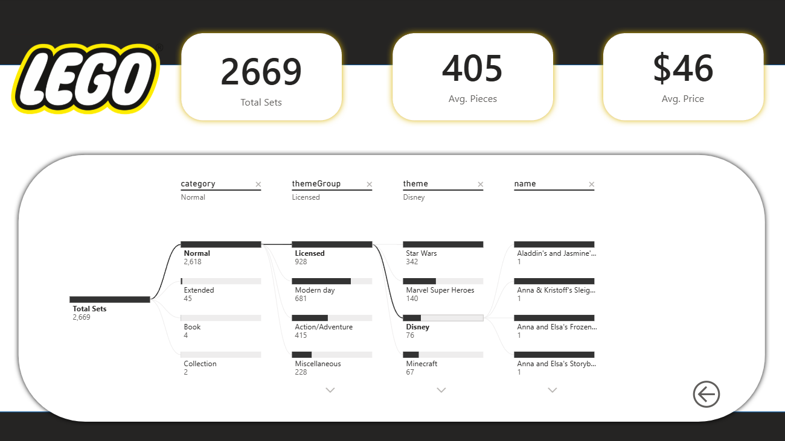
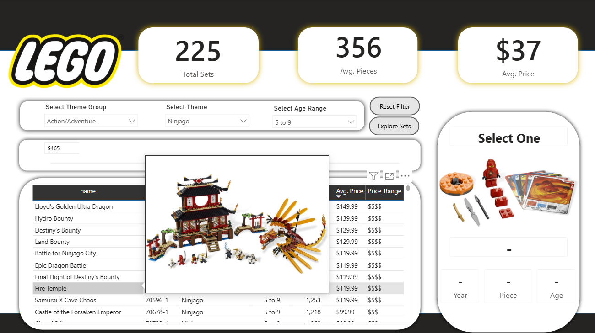

# LEGO Set Catalog Analytics

## Overview

This Power BI project explores a LEGO product catalog through set counts, pricing, piece counts, themes and age ranges. It includes the source CSV, a saved PBIX report and four dashboard screenshots showing overview, set exploration, decomposition and tooltip views. The local audit establishes the raw file's size and missing-value profile independently of the dashboard screenshots. It also verifies the report package and layout structure without claiming to execute its compressed model. The project is useful for demonstrating product-catalog exploration and interactive BI design, but the displayed 2,669-set population must not be confused with the 18,457 records in the source CSV. Native filtering, transformation lineage and refresh remain to be confirmed in Power BI Desktop.

## Business problem and objectives

A large catalog makes it difficult to compare themes, price points, age recommendations and set complexity. The dashboard supports filtered exploration and individual-set lookup. It does not contain sales, stock or customer demand data and therefore cannot establish revenue, profitability or commercial demand.

## Technology stack

Power BI Desktop report (`.pbix`), Power Query/DAX as documented by the original project, CSV data and PNG screenshots. No Python, SQL, JavaScript application or independent transformation source was supplied. The added standard-library Python script profiles the CSV; it does not recreate the Power BI model.

## Dataset and verified observations

[lego_sets.csv](Dataset/lego_sets.csv) has **18,457 rows**, 14 fields and 18,457 distinct `set_id` values, covering **1970–2022** and 154 themes. Fields include name, theme/subtheme/group, category, pieces, minifigs, minimum age, US retail price and Brickset image/detail URLs. The inherited documentation credits Maven Analytics; the exact download URL and redistribution license were not supplied. Brickset URLs are functional dataset references and are preserved.

| Field | Populated rows | Missing rows |
| --- | ---: | ---: |
| pieces | 14,533 | 3,924 |
| minifigs | 8,399 | 10,058 |
| agerange_min | 6,787 | 11,670 |
| US_retailPrice | 6,982 | 11,475 |

The mean listed price among the 6,982 priced rows is approximately $37.53. Missing prices are not zeros. This is an incomplete product catalog, not an inflation-adjusted price series or sales sample.

## Architecture and transformation scope



The original documentation describes column removal, missing-value handling and derived price/age bands in Power Query, plus DAX counts and averages. Those transformations are not available as standalone M/DAX source. The compressed DataModel was not executed or reverse-engineered; confirm the exact row filters and measures in Desktop before relying on them. The discrepancy between 18,457 source rows and 2,669 screenshot sets remains explicitly unresolved.

## Dashboard features and screenshots

The report layout contains three named pages: `Page 1`, `Set Explore`, and `Thumbnail` (26, 12 and 1 visual containers). Screenshots show theme/name/age/price selectors, set count, average pieces, average price, detail tables, set images and a decomposition tree. Interactive behavior and external image availability were not tested.






The inherited banner was removed because it combines personal promotion with inconsistent headline metrics. The four actual dashboard screenshots are preserved unchanged.

## Project structure

```text
Dashboard/   LEGO Sets Dashboard.pbix
Dataset/     lego_sets.csv
Images/      four original dashboard screenshots
scripts/     profile_data.py
README.md    documentation and limitations
AUDIT.md     audit results
ATTRIBUTION.md
```

## Installation and execution

For a data-only check, use Python 3.10+:

```sh
python3 scripts/profile_data.py
```

For the dashboard, open [LEGO Sets Dashboard.pbix](Dashboard/LEGO%20Sets%20Dashboard.pbix) in Power BI Desktop on Windows. Inspect Data source settings and repoint the local CSV source to `Dataset/lego_sets.csv`. Refresh, review transformations and reconcile the filtered population before use. The original local source binding may require adjustment; no working refresh is claimed on this Mac.

## Validation, attribution and license

CSV parsing, unique IDs, missing-value counts, ZIP integrity and report-layout JSON were checked locally. See [AUDIT.md](AUDIT.md). Original dashboard authorship is credited to **Mrinal Sen Gupta**; dataset credit to **Maven Analytics** is preserved. LEGO and Brickset names/images are third-party materials. No LICENSE was supplied despite the original README mentioning one. Confirm redistribution rights separately; see [ATTRIBUTION.md](ATTRIBUTION.md). `amrut-mdsh` identifies the intended portfolio maintainer, not replacement authorship.

## Future improvements

Export and version Power Query/DAX source, reconcile the filtered population, document external image rights and add a refresh validation checklist.
